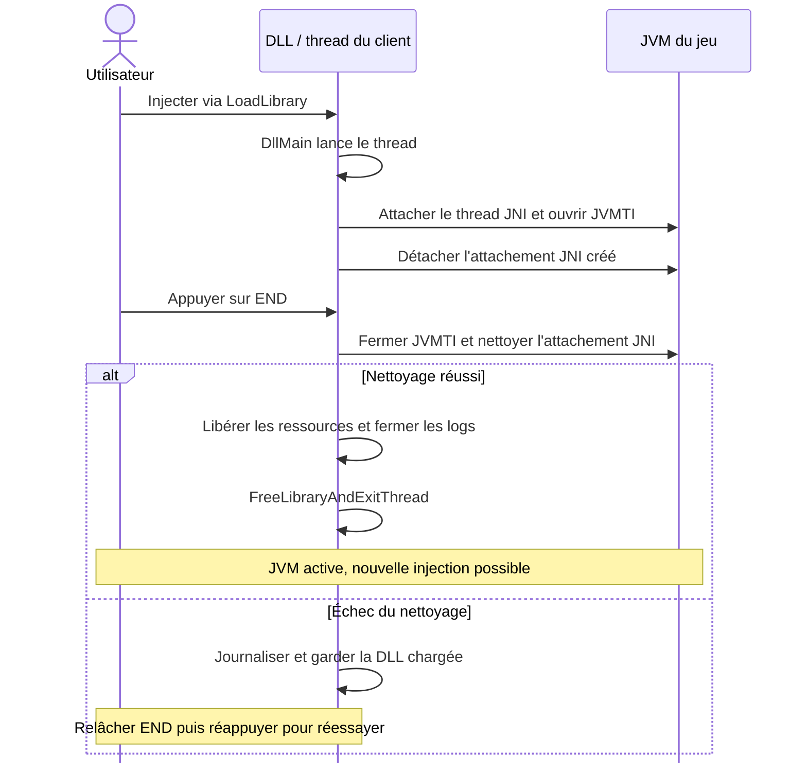

# Rust Minecraft Client Boilerplate

Base minimale en Rust pour créer un client Minecraft injectable sous forme de
DLL : connexion à la JVM existante via JNI/JVMTI, logs et déchargement avec **END**.
Cible : **Windows x64 et Minecraft Java 1.21 avec Java 21 x64**.

## Quickstart

Prérequis : Git, Rust stable avec la chaîne `x86_64-pc-windows-msvc`, les outils
C++ de Visual Studio (avec le SDK Windows) et un JDK 21 x64.

```powershell
git clone https://github.com/Sol1de/Rust-mc-client-boilerplate.git
cd Rust-mc-client-boilerplate
cargo build --release
```

La DLL est produite dans `target/release/ares_client.dll` ; le nom du crate est
encore `ares_client`. Cargo télécharge et met les dépendances en cache.
Conserver `Cargo.toml` et `Cargo.lock` dans Git.

1. Démarrer Minecraft avec Java 21 x64.
2. Charger la DLL dans le processus Java du jeu avec un injecteur externe,
   par exemple Process Hacker. Utiliser le chargeur Windows (`LoadLibrary`) ;
   le *manual map* n'est pas pris en charge.
3. Vérifier les messages `connected to JVM` et `press END to unload` dans
   `%TEMP%\ares_client-<PID>.log`.
4. Appuyer sur **END** pour nettoyer les ressources et réellement décharger la DLL.
5. Une fois le module déchargé, injecter à nouveau pour démarrer une nouvelle session.

Si le nettoyage échoue, la DLL reste chargée et l'erreur est journalisée.
Relâcher END puis appuyer de nouveau pour réessayer. END reste également disponible
si la connexion initiale échoue. Éviter de charger plusieurs fois la DLL avant son
déchargement : chaque chargement Windows supplémentaire peut retenir le module.

Pour suivre les logs depuis un terminal séparé, remplacer `1234` par le PID du jeu :

```powershell
Get-Content "$env:TEMP\ares_client-1234.log" -Wait
```

Les messages sont aussi envoyés au débogueur Windows via `OutputDebugString`.

## Fonctionnement



- **JNI** permet d'accéder à la JVM. Le thread s'attache en mode daemon pour les
  opérations qui le nécessitent, puis détache l'attachement qu'il a créé.
- **JVMTI** fournit l'interface d'instrumentation. Le même environnement est conservé
  jusqu'à sa fermeture réussie. La JVM du jeu reste en vie.
- **Déchargement** : les ressources Rust sont libérées avant
  `FreeLibraryAndExitThread`, qui termine le thread et libère la référence à la DLL.
  Aucun appel JNI/JVMTI n'est effectué dans `DllMain`.

## Où ajouter son code

| Fichier | Rôle |
| --- | --- |
| [src/lib.rs](src/lib.rs) | Entrée de la DLL et orchestration du cycle de vie. |
| [src/jvm.rs](src/jvm.rs) | Découverte de la JVM, attachement JNI et environnement JVMTI. |
| [src/hotkey.rs](src/hotkey.rs) | Détection de END et nouvelle tentative après un échec. |
| [src/log.rs](src/log.rs) | Journal par processus et sortie débogueur. |

Ajouter la logique du client dans le thread de `src/lib.rs`, après une initialisation
réussie. Garder les `JNIEnv` et références locales JNI sur leur thread d'origine.
La base n'installe aucun callback et ne transforme aucune classe. Si vous ajoutez
des callbacks ou des threads, prévoir leur arrêt et attendre leur fin avant de
décharger la DLL.

## Vérification

```powershell
cargo fmt --check
cargo clippy --all-targets -- -D warnings
cargo test
cargo test --release
```

Les tests unitaires couvrent les erreurs d'initialisation, la propriété de
l'attachement JNI, la conservation du bon environnement JVMTI, le nettoyage
répété et le réarmement de END après un échec.

Pour vérifier trois cycles de connexion/nettoyage sur une vraie JVM avec
`-Xcheck:jni`, adapter le chemin du JDK puis lancer le test dédié :

```powershell
$env:JAVA_HOME = 'C:\chemin\vers\jdk-21'
$env:PATH = "$env:JAVA_HOME\bin;$env:PATH"
cargo test jvm::smoke::jdk21_lifecycle -- --ignored --exact --nocapture --test-threads=1
```

Ce test couvre la connexion JVM/JVMTI. Pour vérifier le cycle complet dans Minecraft :
**injecter → END → vérifier que le jeu fonctionne encore → réinjecter**.
